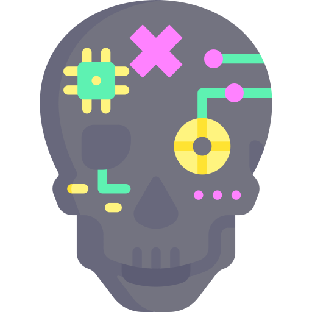

<p align="center">
  
</p>

<h1 align="center">CyberMac</h1>

<p align="center">Native mod management for Cyberpunk 2077 on Mac.</p>

<p align="center">
  <a href="#getting-started">Getting started</a> ·
  <a href="#using-cybermac">Usage</a> ·
  <a href="#documentation">Documentation</a> ·
  <a href="https://github.com/Ayush-Singh-31/CyberMac/issues">Report an issue</a>
</p>

CyberMac brings script mods, clothing additions and body shaping into one macOS app.
Import a mod ZIP, choose what to install, and let CyberMac prepare the files,
keep backups and verify the installation.

Built with Swift and SwiftUI for **Apple Silicon**. Tested with the **Mac App Store version of Cyberpunk 2077, version 2.5**.

## Features

- **Script mods**: Import redscript mods and input mappings, with compilation and activation handled in the app.
- **Clothing additions**: Browse clothing collections, select individual pieces and add them as separate inventory items.
- **Body shaping**: Apply the Lethal Curves maximum preset across inventory, Photo Mode, first person and motorcycle gameplay.
- **Install and restore**: Complete installation through macOS Installer, with verified backups and a **Restore previous files** action.
- **Mod library**: Manage imports, choose variants and review installation history from one place.
- **Diagnostics**: Check setup, inspect packages and record local test sessions.

See [tested mods](KNOWN_WORKING_MODS.md) for examples.

## Getting started

### Requirements

- macOS 15 or later on Apple Silicon.
- Cyberpunk 2077: Ultimate from the Mac App Store.
- Xcode with the Swift 6 toolchain to build from source.

For script mods, import the macOS redscript release ZIP into CyberMac. Game 2.5
uses redscript **0.5.32 or newer**. Import the macOS input-loader ZIP when a mod
includes input mappings.

### Run from source

```sh
git clone https://github.com/Ayush-Singh-31/CyberMac.git
cd CyberMac
swift run CyberMacApp
```

Clothing and body conversion use additional local tools. Follow the
[build guide](docs/building.md) to configure them and build `dist/CyberMac.app`.
The repository contains CyberMac's source; game files and mod downloads are
supplied from your own installation and downloads.

## Using CyberMac

### Install mods

1. Open **Install mods** and drop in a ZIP, or choose a file.
2. Select the clothing pieces or variant you want.
3. Complete macOS Installer when it opens.
4. Launch the game and load your save.

Clothing additions appear as inventory items ready to equip. Body presets apply
to V's appearance. Imports are queued, and each entry keeps its installation
details and recovery options together.

### Restore an installation

Select the import and choose **Restore previous files**. When several installs
share game archives, restore them in reverse installation order.

CyberMac stores downloads, generated files, history and backups in
`~/Library/Application Support/CyberMac`.

### Command-line tools

The `cybermac` CLI provides setup checks, package inspection and preparation tools.

```sh
swift run cybermac doctor
swift run cybermac scan "/path/to/mod.zip"
swift run cybermac help
```

## Documentation

| Guide | Contents |
| --- | --- |
| [Building CyberMac](docs/building.md) | Source builds, conversion tools and local app packaging |
| [Clothing additions](docs/clothing-additions.md) | Selecting garments, inventory delivery and restoration |
| [Body mods](docs/body-mods.md) | Preparing and installing the Lethal Curves gameplay preset |
| [Tested mods](KNOWN_WORKING_MODS.md) | Reported gameplay results and setup notes |
| [Installation and recovery](SAFETY.md) | Backups, verification, storage and troubleshooting |
| [Changelog](CHANGELOG.md) | Current development features and fixes |

## Contributing

Bug reports, compatibility reports and pull requests are welcome. Include your
macOS version, game version, storefront and the mod you're using so results are
easy to reproduce. See [CONTRIBUTING.md](CONTRIBUTING.md) for development checks.

## License and credits

CyberMac is licensed under the [MIT License](LICENSE). See
[third-party notices](THIRD_PARTY_NOTICES.md) for archive implementation credits.
Mod authors retain ownership of their work; download mods from their original
pages. CyberMac is an independent community project.
